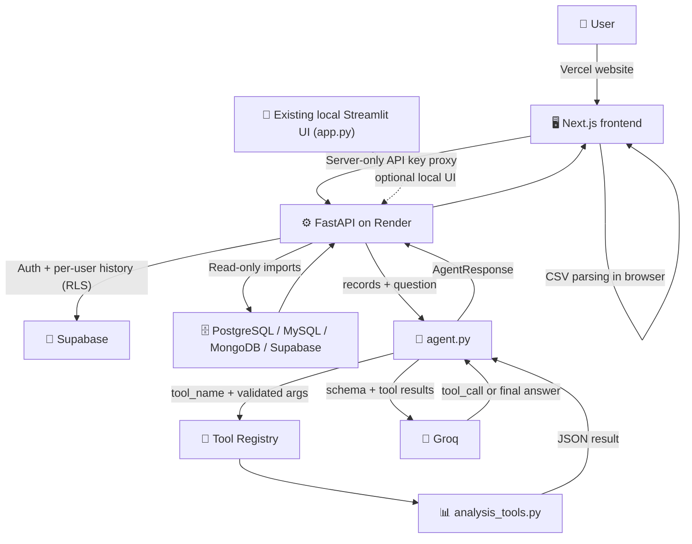

# 🤖 AI Data Analyst

> Upload a CSV. Ask questions in natural language. Get AI-powered insights, charts, and reports — all calculated in Python, explained by Groq.

---

## 📌 Project Overview

**AI Data Analyst** is a complete, production-quality AI agent for exploratory data analysis. It is built as a portfolio project for a fresher AI Engineer in 2026 and demonstrates real-world skills including:

- LLM tool/function calling with Groq
- Secure, validated data processing with Pandas
- Professional Streamlit frontend with dark-mode design
- Comprehensive unit, integration, and adversarial testing
- Agent evaluation with 50+ benchmark test cases
- Docker containerisation

### Problem Statement

Analysing a new dataset manually requires coding knowledge and hours of work. **AI Data Analyst** lets non-technical users ask plain English questions and receive accurate answers backed by real Python calculations — not hallucinated statistics.

---

## ✨ Features

| Feature | Description |
|---------|-------------|
| 📁 CSV Upload | Upload datasets up to 50 MB with encoding detection |
| 🔌 Database Imports | Read-only imports from PostgreSQL, MySQL, MongoDB, and Supabase |
| 📊 Data Explorer | Preview, profile, column stats, and missing-value analysis |
| 💬 AI Chat | Multi-turn natural-language Q&A with conversation history |
| 👤 Optional Accounts | Use without signing in, or register/sign in with Supabase Auth |
| 🕘 Saved History | Signed-in users can view their saved questions and answers |
| 🌙 Dark Mode | Toggle the app theme from the sidebar |
| 🔢 Aggregation | Sum, mean, min, max, count, median — grouped by any column |
| 🏆 Top-N Analysis | Top or bottom N categories by any metric |
| 🔍 Filtering | Row filtering with 9 explicit operators |
| 📈 Interactive Charts | Bar, line, scatter, histogram, correlation heatmap |
| 🚨 Outlier Detection | IQR-based outlier identification |
| 🔗 Correlation | Pearson, Spearman, Kendall correlation matrices |
| 📝 Quality Report | Automated data quality score with warnings |
| 🔒 Security | No eval/exec, no shell commands, tool allowlist |
| 🐳 Docker | Containerised deployment |
| 🧪 Testing | 100+ pytest tests, no API key required |

---

## 🏗️ Architecture



**Security boundary:** The full dataset is not uploaded to Groq; the agent sends schema details and deterministic analysis-tool results needed to answer each question. Depending on the selected analysis tool, those results can include matching row values or category labels. Do not analyze information you are not authorized to send to the configured Groq service. Database connections only execute app-generated, read-only imports; arbitrary SQL is not accepted. In the Next.js frontend, database credentials stay in component memory and are sent through a same-origin server proxy to FastAPI; the Render API key is never exposed to the browser. Signed-in history stores questions and answers in the user's Supabase project and is protected with row-level security.

---

## 🛠️ Technology Stack

| Layer | Technology |
|-------|-----------|
| Language | Python 3.11 |
| Deployed Frontend | Next.js 16 (Vercel) |
| Existing local UI | Streamlit 1.40 |
| AI | Groq (tool calling) |
| Data | Pandas 2.2, NumPy 2.1 |
| Charts | Plotly 5.24 |
| Validation | Pydantic 2.9 / Pydantic-Settings |
| Database | SQLAlchemy, Psycopg, PyMySQL, PyMongo, Supabase REST/Auth |
| Testing | Pytest 8.3 |
| Containerisation | Docker |
| Version Control | Git |

---

## 📁 Project Structure

```
ai-data-analyst/
├── app.py                  # Streamlit application entry point
├── agent.py                # LLM tool-calling agent loop
├── analysis_tools.py       # 10 deterministic Pandas analysis functions
├── chart_builder.py        # Plotly chart generation
├── config.py               # Pydantic Settings (env var configuration)
├── data_loader.py          # CSV ingestion and validation
├── database_connectors.py  # Read-only database discovery and imports
├── user_services.py        # Supabase Auth and user-scoped history
├── backend_api.py          # FastAPI auth, history, and database API
├── backend_client.py       # Internal Streamlit-to-FastAPI client
├── evaluation.py           # Evaluation framework and metrics
├── requirements.txt        # Pinned Python dependencies
├── .env.example            # Environment variable template
├── .gitignore              # Git ignore rules
├── Dockerfile              # Container build instructions
├── docker-compose.yml      # Internal API + Streamlit deployment
├── render.yaml             # Render FastAPI Blueprint
├── docs/deployment.md      # Vercel + Render + Supabase instructions
├── frontend/               # Vercel Next.js UI and server-side API proxy
├── assets/brand.svg         # Shared application logo
├── README.md               # This file
│
├── tests/
│   ├── conftest.py         # Shared pytest fixtures
│   ├── test_data_loader.py # CSV ingestion tests
│   ├── test_analysis_tools.py  # Analysis tool tests
│   ├── test_chart_builder.py   # Chart generation tests
│   ├── test_agent.py       # Agent unit tests (mocked LLM)
│   ├── test_security.py    # Security-focused tests
│   ├── test_database_connectors.py # Database import and security tests
│   ├── test_user_services.py # Auth and history service tests
│   ├── test_backend_api.py   # FastAPI authorization and endpoint tests
│   └── test_app_navigation.py # Account page navigation tests
│
├── evaluation/
│   ├── benchmark.jsonl     # 50+ benchmark test cases
│   └── run_evaluation.py   # Evaluation runner script
│
├── sample_data/
│   └── sample_sales.csv    # 150-row fictional sales dataset
│
├── supabase/
│   └── analysis_history.sql # History table and RLS policies
│
└── docs/
    ├── architecture.md     # Architecture documentation
    └── evaluation_report.md # Evaluation results
```

---

## 🚀 Installation

### Prerequisites

- Python 3.11 or later
- Groq API key ([get one here](https://console.groq.com/keys))
- Git

### 1. Clone the repository

```bash
git clone https://github.com/YOUR_USERNAME/ai-data-analyst.git
cd ai-data-analyst
```

### 2. Create a virtual environment

```bash
python -m venv venv

# Windows
venv\Scripts\activate

# macOS / Linux
source venv/bin/activate
```

### 3. Install dependencies

```bash
pip install -r requirements.txt
```

### 4. Configure environment

```bash
# Windows PowerShell
Copy-Item .env.example .env

# macOS / Linux
cp .env.example .env
```

Edit `.env` and add your Groq key. Generate a long random internal API key and
use the same value for the frontend and FastAPI service:

```env
GROQ_API_KEY=your-groq-api-key
GROQ_MODEL=openai/gpt-oss-120b
APP_API_URL=http://127.0.0.1:8000
APP_API_KEY=your-long-random-secret
```

Generate a key with `python -c "import secrets; print(secrets.token_urlsafe(48))"`.
Never commit `.env`. The app uses Groq's OpenAI-compatible Chat Completions API.

### Optional sign-in and analysis history

To enable email/password accounts and saved history, set the Supabase project's
URL and **anon/publishable key** in `.env`:

```env
SUPABASE_URL=https://your-project.supabase.co
SUPABASE_ANON_KEY=your-supabase-anon-or-publishable-key
```

Never put a Supabase service-role key in this app. Run
[`supabase/analysis_history.sql`](./supabase/analysis_history.sql) once in the
Supabase SQL Editor to create the history table and per-user row-level security
policies. Configure email confirmation and password rules in Supabase Auth.
Without these settings, the app continues to work without sign-in.
The history table stores questions and answers, which may contain information
from the analysis; load history only when signed in to your own account.

To use the account page, click the person icon in the app header. The sign-in
page includes a **Create an account** option; the registration page links back
to sign-in. Guest use remains available from **Continue as guest**.

### Connect a database

In the sidebar, choose **Connect database**, select PostgreSQL, MySQL, MongoDB,
or Supabase, enter the connection details, then select a table or collection to
import. Imports are capped by `MAX_ROWS` and `MAX_COLUMNS`; use database accounts
with read-only privileges and network access restricted to trusted database
hosts. Supabase connections use the project's anon/publishable key and tables
must be exposed through the Data API with suitable row-level security policies.
An optional user access token can be provided for rows protected by authenticated
user policies; never enter a service-role key.

Connection credentials are not saved to the history table or `.env`; they remain
in the active Streamlit session until disconnected or signed out. Only connect
to databases you own or are authorized to access. Imported rows stay in app
memory for analysis and are not persisted by this feature.
For a deployment, set `APP_ENV=production`, restrict outbound network access
with firewall rules, and allow only database hosts you trust. Production mode
rejects database hosts that resolve to private, local, or reserved addresses;
development mode permits local databases for local development.

---

## ▶️ Running Locally

Start FastAPI and Streamlit in separate terminals from the project root. Both
read the same `.env`; FastAPI owns Supabase and external database calls, while
the Streamlit server accesses it with the internal API key.

Terminal 1:

```bash
uvicorn backend_api:app --host 127.0.0.1 --port 8000
```

Terminal 2:

```bash
streamlit run app.py --server.address 127.0.0.1
```

The application opens at **http://localhost:8501**. FastAPI health is available
at **http://localhost:8000/health**. Accounts and database imports require the
backend; file upload and guest analysis remain available without an account.

### Run the Vercel-style Next.js frontend locally

In a third terminal, from the repository root:

```powershell
Set-Location frontend
Copy-Item .env.example .env.local
npm install
npm run dev
```

In `frontend/.env.local`, set `BACKEND_API_URL=http://127.0.0.1:8000` and use
the same `APP_API_KEY` as FastAPI. Open **http://localhost:3000**. Keep both
values server-only; do not rename them to `NEXT_PUBLIC_*`.

---

## 🐳 Docker

Set `APP_API_KEY`, `GROQ_API_KEY`, and, if using accounts, `SUPABASE_URL` plus
the anon/publishable key in `.env`. Then build and launch both services:

```bash
docker compose up --build
```

Visit **http://localhost:8501**. FastAPI is only exposed inside the Compose
network, not directly to the host.

> **Note:** The `.env` file is passed at runtime. It is never baked into the Docker image.

## ☁️ Deploy on Vercel, Render, and Supabase

The deployable Next.js frontend is in [`frontend/`](./frontend). Deploy it to
Vercel with that directory as the project root. Deploy FastAPI on Render using
[`render.yaml`](./render.yaml), then configure the Vercel server-only
`BACKEND_API_URL` and `APP_API_KEY` values. Configure Supabase URL/key on
Render and run [`supabase/analysis_history.sql`](./supabase/analysis_history.sql).

Follow [`docs/deployment.md`](./docs/deployment.md) for the complete ordered
setup, environment variables, and post-deploy checks.

## 🧰 Backend and database setup recommendations

- Use a dedicated Supabase project. Apply
  [`supabase/analysis_history.sql`](./supabase/analysis_history.sql), keep RLS
  enabled, and configure email confirmation, password policy, and account
  recovery in Supabase Auth.
- Store the Groq, Supabase anon, and internal API keys in your deployment
  platform's secret manager. Rotate the internal key and use HTTPS/TLS at the
  public reverse proxy; never expose port 8000 directly to the internet.
- For each external database, create a least-privilege read-only user, enforce
  TLS, and restrict network access to the API host. Do not use production
  credentials in development.
- Set retention and backup policies for Supabase history, and let users know
  saved questions and answers may contain analyzed information. Add monitoring,
  centralized error reporting, and distributed rate limiting before a
  multi-instance public production deployment.
- In production, restrict API egress to trusted database hosts. Current
  in-process authentication rate limits are per worker and are not a substitute
  for an edge proxy or shared rate-limit store.

---

## 💡 Sample Questions

Once you've uploaded a CSV, try asking:

```
What is the total revenue?
Which product has the highest total revenue?
Show the top 5 products by revenue as a bar chart.
What is the average quantity sold by region?
Find all missing values in the dataset.
Plot monthly sales trends as a line chart.
Detect unusual values in numeric columns.
What is the correlation between Quantity and Revenue?
Generate a full data quality report.
Show the distribution of Revenue as a histogram.
Which customer segment contributes the most revenue?
Filter orders where Revenue is greater than 5000.
```

---

## 🧪 Running Tests

No API key is required to run the core test suite — all LLM calls are mocked.

```bash
# Run all tests
pytest tests/ -v

# Run with coverage report
pytest tests/ --cov=. --cov-report=html -v

# Run a specific test file
pytest tests/test_analysis_tools.py -v

# Run security tests only
pytest tests/test_security.py -v
```

### Test Categories

| Test File | What it Tests |
|-----------|--------------|
| `test_data_loader.py` | CSV parsing, size limits, encoding, injection |
| `test_analysis_tools.py` | All 10 analysis functions, 60+ cases |
| `test_chart_builder.py` | All 5 chart types, error handling |
| `test_agent.py` | Agent loop, tool validation (mocked LLM) |
| `test_security.py` | No eval/exec, operator allowlists |

---

## 📊 Evaluation

Run the evaluation against all 52 benchmark test cases:

```bash
# Requires GROQ_API_KEY
python evaluation/run_evaluation.py
```

This generates a full report in `docs/evaluation_report.md`.

### Benchmark Categories

- ✅ Basic aggregations (8 cases)
- ✅ Grouping and filtering (10 cases)
- ✅ Missing value analysis (4 cases)
- ✅ Summary statistics (3 cases)
- ✅ Chart generation (5 cases)
- ✅ Correlation analysis (3 cases)
- ✅ Outlier detection (3 cases)
- ✅ Data quality reports (2 cases)
- ⚠️ Ambiguous/unsupported questions (4 cases)
- ⚠️ Missing columns (2 cases)
- 🔒 Adversarial / prompt injection (3 cases)
- 🔢 Edge cases (2 cases)

---

## 🔒 Security and Privacy

### What is sent to Groq

- Dataset schema: column names, data types, row count, missing counts
- User's natural-language question
- Tool execution results (aggregated summaries, not raw cell values)

### What is NEVER sent to Groq

- Individual CSV cell values
- Raw file contents
- API keys or credentials
- Uploaded file binary data

### Security measures

- ❌ No `eval()` or `exec()` anywhere in the codebase
- ❌ No shell command execution from model output
- ✅ Tool allowlist — only 10 whitelisted functions can be called
- ✅ All column names validated against current dataset
- ✅ Filter operators validated against explicit allowlist
- ✅ Tool-call count bounded per request
- ✅ File size, row, and column limits enforced
- ✅ API keys loaded from environment, never logged or returned

### Known Limitations

- The Groq API provider receives the dataset schema. For highly sensitive data, review Groq's data usage policies.
- Session data is not encrypted at rest in the Streamlit default deployment.
- Rate limiting is basic (API-level only in the prototype).

---

## ⚙️ Configuration Reference

| Variable | Default | Description |
|----------|---------|-------------|
| `GROQ_API_KEY` | — | **Required for AI chat.** Your Groq API key |
| `GROQ_MODEL` | `openai/gpt-oss-120b` | Groq-hosted model name |
| `GROQ_MAX_TOKENS` | `4096` | Max tokens per response |
| `MAX_UPLOAD_SIZE_MB` | `50` | Max CSV upload size |
| `MAX_ROWS` | `500000` | Max dataset rows |
| `MAX_COLUMNS` | `200` | Max dataset columns |
| `MAX_TOOL_CALLS` | `10` | Max tool calls per question |
| `API_TIMEOUT_SECONDS` | `60` | API request timeout |
| `MAX_RESULT_ROWS` | `1000` | Max rows in filter results |
| `MAX_CHART_CATEGORIES` | `50` | Max chart categories |

---

## 📈 Evaluation Results

> Results are pending. Run `python evaluation/run_evaluation.py` to generate results.

See [docs/evaluation_report.md](docs/evaluation_report.md) for the full report.

---

## 🗺️ Future Improvements

- [ ] Conversation memory with persistent history
- [ ] Excel (.xlsx) upload support
- [ ] Multiple-file analysis and joining
- [ ] FastAPI backend for production deployment
- [ ] User authentication
- [ ] PDF report download
- [ ] LangGraph multi-agent orchestration
- [ ] SQL database analysis
- [ ] Real-time streaming responses
- [ ] Model usage and cost dashboard

---

## 📄 Data Sources

- `sample_data/sample_sales.csv` — Entirely fictional sales data generated for testing. Contains no real personal information.

---

## 👤 Author

**Gubendhiran** — AI Engineer Portfolio Project (2026)

This project demonstrates:
- Full-stack AI application development
- LLM tool calling and agent orchestration
- Secure data processing
- Professional software engineering practices (testing, documentation, containerisation)

---

## 📝 License

MIT License — see LICENSE file for details.
