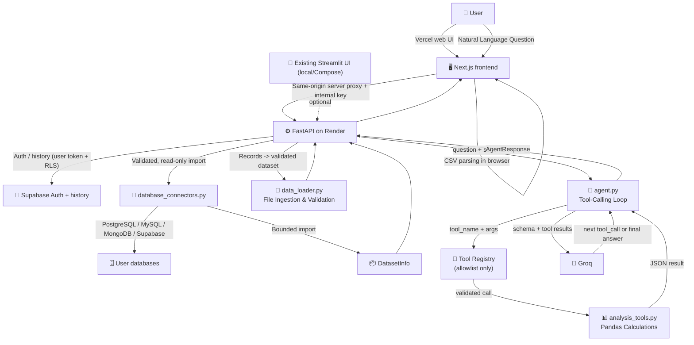

# Architecture — AI Data Analyst

## System Overview



## Module Responsibilities

| Module | Responsibility |
|--------|---------------|
| `app.py` | Streamlit UI, session state, chat interface |
| `agent.py` | LLM tool-calling loop, security validation |
| `analysis_tools.py` | 10 deterministic Pandas analysis functions |
| `chart_builder.py` | Plotly chart generation from validated data |
| `data_loader.py` | CSV ingestion, validation, encoding detection |
| `database_connectors.py` | Bounded, read-only PostgreSQL, MySQL, MongoDB, and Supabase imports |
| `user_services.py` | Supabase email/password auth and user-scoped history |
| `backend_api.py` | Internal FastAPI boundary for auth, history, and database operations |
| `backend_client.py` | Streamlit server-side client for the internal API |
| `frontend/` | Vercel Next.js workspace, multi-turn chat, result visualizations, and same-origin API proxy |
| `frontend/lib/workspace.ts` | Browser-local IndexedDB storage for the active dataset and conversation |
| `render.yaml` | Render FastAPI service blueprint |
| `config.py` | Pydantic Settings, environment variables |
| `evaluation.py` | Benchmark framework, metrics collection |

## Data Flow — Security Boundary

```
[CSV parsed in browser / database import]
    │
    ▼ (same-origin Next.js route handler; internal key stays server-side)
[FastAPI on Render]
    ├── Supabase auth/history (user bearer token, RLS)
    ├── external database discovery/import (read-only connectors)
    └── records -> DatasetInfo -> local analysis tools -> Groq
```

**What goes to Groq:**
- Dataset filename
- Column names and data types
- Row count, missing counts, duplicate count
- User's natural-language question
- Tool execution results. Depending on the tool, results may include matching
  row values, category labels, aggregates, or chart data.

**What NEVER goes to Groq:**
- The full dataset or raw file content
- API keys or credentials
- Database connection credentials

## Security Model

1. **No eval/exec**: All calculations use Pandas functions with validated arguments.
2. **Tool allowlist**: Only 10 registered tools can be called by the LLM.
3. **Argument validation**: Column names, operators, and limits validated before execution.
4. **Read-only database access**: App-generated SELECT/import operations only; SQL identifiers are dialect-quoted and results are capped.
5. **Transport protection**: Database TLS certificate verification is enabled by default; production mode rejects hosts resolving to non-public addresses.
6. **Credential isolation**: Browser database credentials are held in component memory and sent to FastAPI through the same-origin server proxy. They are not persisted, logged, or added to history.
7. **Account isolation**: Supabase history is protected by per-user row-level security; no service-role key is accepted. Supabase/database calls run in FastAPI.
8. **Bounded execution**: Maximum tool calls, row limits, timeouts, and result size limits are enforced.
9. **Secret isolation**: API keys and passwords are never rendered in plain text or returned to the UI.
10. **Session isolation**: Auth tokens are held in HTTP-only cookies; the active dataset and chat are stored in browser-local IndexedDB to survive navigation and refresh. Users should clear the workspace on shared devices.
11. **Internal API**: FastAPI requires a constant-time-checked shared key on operational routes. Vercel route handlers add the key server-side, and it is never exposed as a public frontend variable.
12. **Payload bounds**: The Vercel proxy caps JSON requests at 3.5 MB, while the UI limits datasets to about 2.9 MB to leave room for conversation context and keep requests below Render's 3 MB limit.

The agent sends selected tool results to Groq, so those results may contain
values needed for the requested analysis. Supabase history stores questions and
answers only; users should not save sensitive content unless authorized.
